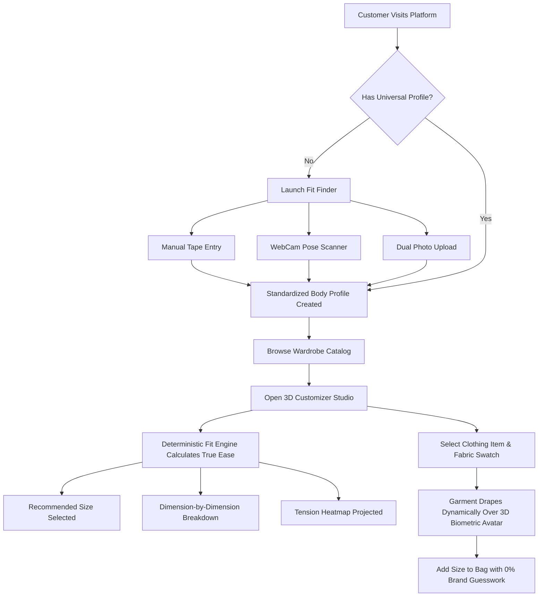

# FitMatch AI — Universal Body Measurement & 3D Volumetric Fit Engine

<div align="center">


**Precision apparel fit, deterministic ease calculations, and real-time 3D holographic wardrobe try-on.**

[](#)
[](#)
[](#)
[](#)
[](#)
[](#)

</div>

---

## ✦ Overview

**FitMatch AI** is a minimal luxury fashion-tech platform built to permanently solve e-commerce sizing uncertainty and reverse logistics waste. Traditional apparel sizing relies on vanity sizing conventions and arbitrary brand comparisons (*e.g., "What size do you wear in Nike or Zara?"*), resulting in return rates exceeding 38% in premium apparel categories.

FitMatch AI replaces brand guesswork with **standardized customer biometric profiles** and **direct physical garment ease comparisons**:

$$\text{Garment Ease} = \text{Physical Garment Dimension} - \text{Customer Body Dimension}$$

The platform couples a **deterministic category-aware sizing algorithm** with a **real-time 3D biometric holographic customizer** that drapes garments directly over your custom anatomical morphology.

---

## ✦ Core Features & Capabilities

### 1. Multi-Modal Universal Body Ingestion
FitMatch AI establishes a single, universal customer measurement profile persisted across all brands:
* **Mode A: Guided Manual Tape Entry**
  * Step-by-step visual placement guides for Chest, Waist, Hips, Shoulders, Inseam, Neck, and Sleeve length.
  * Instant metric ($\text{cm}$) / imperial ($\text{inches}$) conversion.
  * Strict physiological validation bounds (rejecting anatomically impossible inputs).
* **Mode B: Real-Time WebCam Silhouette Scanner**
  * Direct browser camera stream with holographic A-pose alignment guide.
  * 3-second capture countdown with motion stability checks.
  * Calibrated computer vision estimations with fine-tuning micro-sliders.
* **Mode C: Dual Photo Upload (Front & Profile)**
  * Asynchronous front and lateral portrait dropzones.
  * Automatic aspect ratio, lighting quality, and background contrast checks.

---

### 2. Deterministic Category-Aware Fit Engine
Unlike opaque black-box recommendations, FitMatch AI utilizes transparent biomechanical ease formulas:

* **Category Ease Targets:** Distinct bespoke tolerances for Tailored Jackets ($\sim +10\text{ to }+16\text{ cm}$), Dress Shirts ($\sim +6\text{ to }+10\text{ cm}$), Heavyweight T-Shirts ($\sim +8\text{ to }+14\text{ cm}$), and Selvedge Denim ($\sim +2\text{ to }+5\text{ cm}$).
* **Customer Fit Preferences:** Dynamically adjusts scoring curves between **Slim** (close-to-body), **Regular** (tailored balance), and **Oversized** (relaxed architectural drape).
* **Asymmetric Penalty Function:** Tightness ($\text{Ease} < \text{Target}$) is penalized **$2.5\times$ more severely** than excess room to prevent unwearable constriction.
* **Critical Minimum Boundary Checks:** Flags dealbreakers where a garment will physically fail to button, zip, or restrict shoulder articulation.
* **Biomechanical Tension Stress Mapping:** Generates tension indexes normalized between $-1.0$ (critical pinch) and $+1.0$ (excess loose).
* **Deterministic Dimension-by-Dimension Breakdown:** Surfaces transparent explanations (*e.g., "Chest: +4.2 cm ease (Optimal) • Shoulders: 46.2 cm (Exact match)"*).

---

### 3. Real-Time 3D Biometric Hologram & Dynamic Wardrobe Try-On
Rendered via Three.js and `@react-three/fiber` inside a cinematic obsidian cyber-pod:

* **Full-Body Biometric Avatar:**
  * Procedurally sculpted anatomical cranium, neck, torso, arms, hands, legs, and feet.
  * Glowing cyan neural constellation wireframe network.
  * 14 glowing anatomical landmark nodes tracking joint pivots.
  * Dual radiant energy cores: volumetric pulsing upper chest/heart and solar plexus/navel hubs.
* **Cylindrical Laser Scanner Pod:**
  * 22 vertical holographic laser stream rods with double emitter rings.
  * Sweeping planar horizontal scan disc continuously calibrating the avatar.
  * Concentric floor dais with soft cyan contact shadows.
* **Dynamic Wardrobe Draping (No Static Meshes):**
  * **The Sculptural Trench:** Architectural longline double-breasted overcoat with lapels, waist belt sash, and brass buckle.
  * **Structured Blazer:** Super 150s worsted wool blazer with sharp notched lapels and button closure.
  * **Heavy Cotton T-Shirt:** Dense 280 GSM combed cotton crewneck with ribbed collar and short sleeves.
  * **Mulberry Silk Shirt:** Fluid dress shirt with spread collar, front button placket, and tailored cuffs.
  * **Selvedge Denim Trouser:** Straight-leg Japanese denim jeans with waistband, copper rivet, and ankle taper.
* **Real-Time Fabric Shader Swatches:**
  * Instant PBR updates for **Void Noir**, **Alabaster Chalk**, **Desert Camel**, **Slate Sage**, and **Raw Indigo** modifying roughness, metalness, and clearcoat dynamics.
* **Holographic Fit Bands:**
  * Caliper laser rings at Chest, Waist, Hips, and Shoulders measuring garment ease against body morphology.
* **Biomechanical Tension Heatmap Overlay:**
  * 🟢 **Emerald Green:** Optimal Ease (target bespoke comfort).
  * 🔴 **Crimson Red:** Strained Fit ($<0\text{ cm}$ tight constriction/pinch).
  * 🟡 **Amber Yellow:** Snug tailored contour.
  * 🔵 **Cyan Blue:** Loose oversized drape.

---

## ✦ System Architecture & Directory Layout

```text
FitMatch AI/
├── index.html                   # HTML entry with Playfair & JetBrains font imports
├── vite.config.js               # Optimized Vite bundler configuration
├── tailwind.config.js           # Custom luxury dark-mode theme & glassmorphic utilities
├── postcss.config.js            # PostCSS plugin configurations
├── .gitignore                   # Production repository exclusions
└── src/
    ├── main.jsx                 # React root mount
    ├── App.jsx                  # Master application orchestrator & local storage sync
    ├── index.css                # Global glassmorphism, fonts, and scrollbar rules
    │
    ├── data/
    │   └── products.js          # Physical garment size charts, fabrics, and colorways
    │
    ├── engine/
    │   ├── types.js             # Physiological bounds, category ease matrices, & schemas
    │   └── fitEngine.js         # Deterministic category-aware sizing algorithm & tension map
    │
    └── components/
        ├── 3d/
        │   ├── BiometricHologramModel.jsx # Full-body avatar & dynamic wardrobe draping
        │   ├── ParametricMannequin.jsx    # R3F canvas, cyber lights, & OrbitControls
        │   ├── GarmentHeroScene.jsx       # Hero 3D turntable scene
        │   ├── CyberAvatarModel.jsx       # Standalone biometric avatar module
        │   └── SplineViewer.jsx           # Spline scene embed fallback
        │
        ├── common/
        │   └── Navbar.jsx                 # Luxury glassmorphic navigation header
        │
        ├── hero/
        │   ├── HeroSection.jsx            # Headline, 3D viewport, and call-to-actions
        │   └── FloatingProductCards.jsx   # Docked LiDAR HUD telemetry cards
        │
        ├── onboarding/
        │   ├── FitFinderModal.jsx         # Master multi-modal onboarding modal
        │   ├── ManualMeasurementFlow.jsx  # Interactive tape measurement entry
        │   ├── LiveCameraFlow.jsx         # WebCam stream & pose silhouette alignment
        │   └── PhotoUploadFlow.jsx        # Dual-angle photo quality analyzer
        │
        ├── showcase/
        │   └── LuxuryGrid.jsx             # Interactive luxury wardrobe catalog
        │
        ├── fit-engine/
        │   └── FitDemoSection.jsx         # Live interactive sizing calculation matrix
        │
        └── studio/
            ├── ProductStudio3D.jsx        # 3D customizer, fabric swatches, & telemetry
            └── FitFeedbackModal.jsx       # Customer calibration feedback dialog
```

---

## ✦ Tech Stack

| Domain | Technology | Description |
| :--- | :--- | :--- |
| **Frontend Framework** | **React 18** | Concurrent rendering, state persistence, modular architecture |
| **3D Rendering** | **Three.js** | WebGL graphics, custom procedural spline lathes, PBR materials |
| **3D React Bridge** | **@react-three/fiber** | Declarative Three.js scene graph inside React components |
| **3D Utilities** | **@react-three/drei** | `OrbitControls`, `Float`, `ContactShadows`, procedural lighting |
| **Styling & Design** | **Tailwind CSS** | Custom obsidian luxury palette, glassmorphism, responsive grids |
| **Animation** | **Framer Motion** | Spring-based transitions, dialog animations, and gesture triggers |
| **Icons** | **Lucide React** | Minimalist fashion-tech iconography |
| **Build Tooling** | **Vite 5** | Instant Hot Module Replacement (HMR) and optimized rollup bundle |

---

## ✦ Getting Started Locally

### Prerequisites
* **Node.js**: v18.0.0 or higher
* **npm**: v9.0.0 or higher

### Installation

1. **Clone the repository:**
   ```bash
   git clone https://github.com/maddycode5/FitMatch-AI.git
   cd "FitMatch AI"
   ```

2. **Install dependencies:**
   ```bash
   npm install
   ```

3. **Start the local development server:**
   ```bash
   npm run dev
   ```
   Open [http://localhost:3000](http://localhost:3000) in your browser.

4. **Build for production:**
   ```bash
   npm run build
   ```
   The production-ready output will be generated in the `dist/` directory.

---

## ✦ User Workflows



---

## ✦ Git Commit Architecture

The repository's evolution is cleanly divided into structured milestones:

* `d778eaa`: `chore: initialize FitMatch AI architecture, toolchain, and deterministic fit engine`
* `33c0fd3`: `feat(onboarding): implement multi-modal body measurement ingestion flows`
* `2915209`: `feat(ui): build luxury fashion-tech hero, telemetry HUD, and showcase grid`
* `1582de8`: `feat(3d-studio): deliver full-body biometric hologram model and dynamic wardrobe draping engine`

---

## ✦ License & Attribution

Designed and engineered for **FitMatch AI**. Released under the [MIT License](LICENSE).
Codebase authored by [@maddycode5](https://github.com/maddycode5).

