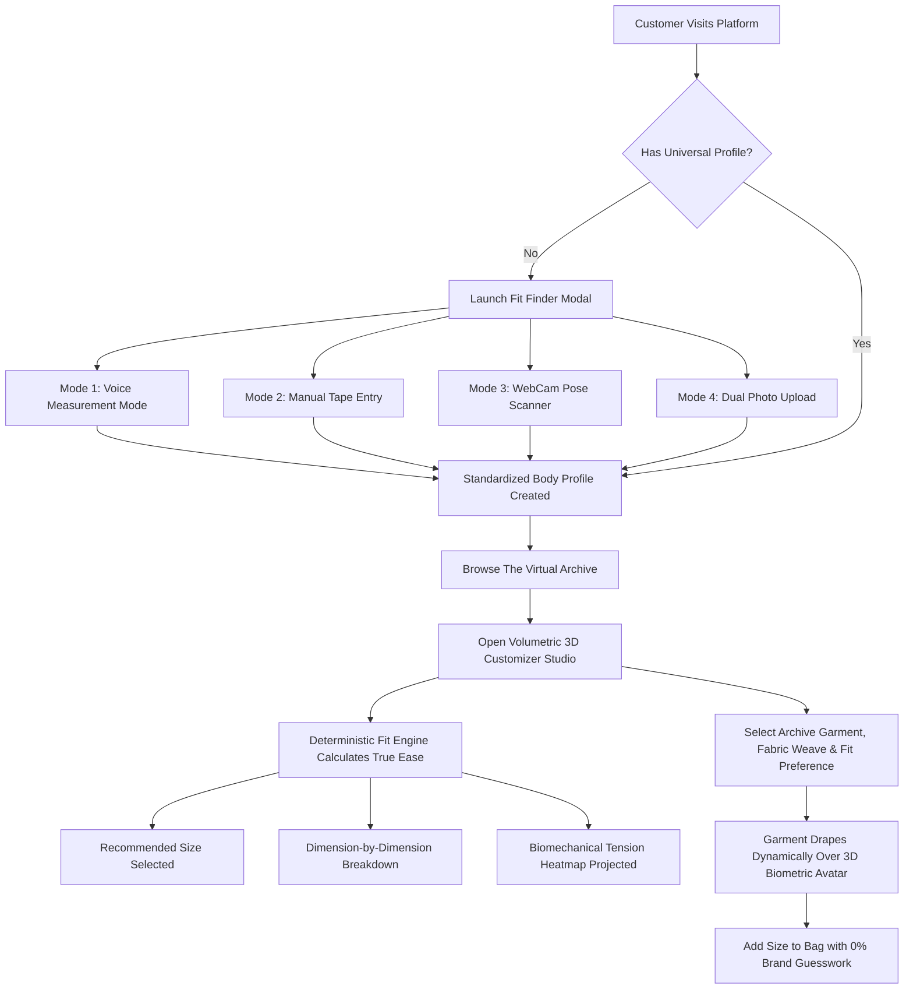

# FitMatch AI — Universal Body Measurement & 3D Volumetric Fit Engine

<div align="center">


**Precision apparel fit, deterministic ease calculations, and real-time 3D holographic wardrobe try-on.**

[](#)
[](#)
[](#)
[](#)
[](#)
[](#)

</div>

---

## Overview

**FitMatch AI** is a minimal luxury fashion-tech platform built to permanently eliminate e-commerce sizing uncertainty and reverse logistics waste. Traditional apparel retail relies on vanity sizing conventions and arbitrary brand comparisons (*e.g., "What size do you wear in Nike or Zara?"*), resulting in return rates exceeding 38% in premium apparel categories.

FitMatch AI replaces brand guesswork with **standardized customer biometric profiles** and **direct physical garment ease comparisons**:

$$\text{Garment Ease} = \text{Physical Garment Dimension} - \text{Customer Body Dimension}$$

The platform couples a **deterministic category-aware sizing algorithm** with a **real-time 3D biometric holographic customizer** that drapes photorealistic garments from **The Virtual Archive** directly over your custom anatomical morphology.

---

## Core Features & Capabilities

### 1. Multi-Modal Universal Body Ingestion
FitMatch AI establishes a single, universal customer measurement profile persisted across all brands:
* **Mode 1: Hands-Free Voice Assistant (Gnani Prisma STT & Timbre TTS Engine)**
  * **Step-by-Step Atelier Voice Guidance:** Speaks professional tailoring instructions sequentially across Upper Body (**1 Chest $\to$ 2 Shoulder $\to$ 3 Neck**) and Lower Body (**1 Waistline $\to$ 2 Hips $\to$ 3 Inseam**).
  * **Gnani Prisma Speech Recognition (STT):** Continuous speech recognition streaming calibrated for Indian English (`en-IN`) and global accents.
  * **Gnani Timbre & Voice Cloning (TTS):** Direct cloud neural voice pipeline with custom voice clone persona support and automatic local browser speech fallback.
  * **Multi-Key Automatic Credit Failover (`GnaniKeyPool`):** Auto-rotates between Primary, Secondary Fallback, and Tertiary Backup API keys if credits exhaust, ensuring 100% continuous uptime.
  * **Natural Language Biometric Parser:** Extracts dimensions and numbers (*e.g., "My chest measurement is 98 centimetres"*), converts units, and validates against human physiological limits.
  * **Interactive Anatomical HUD:** SVG body silhouette with dynamic laser highlight bands illuminating each active measurement zone.
* **Mode 2: Guided Manual Tape Entry**
  * Step-by-step visual placement guides for Chest, Waist, Hips, Shoulders, Inseam, Neck, and Sleeve length.
  * Instant metric ($\text{cm}$) / imperial ($\text{inches}$) conversion.
  * Strict physiological validation bounds (rejecting anatomically impossible inputs).
* **Mode 3: Real-Time WebCam Silhouette Scanner**
  * Direct browser camera stream with holographic A-pose alignment guide.
  * 3-second capture countdown with motion stability checks.
  * Calibrated computer vision estimations with fine-tuning micro-sliders.
* **Mode 4: Dual Photo Upload (Front & Profile)**
  * Asynchronous front and lateral portrait dropzones.
  * Automatic aspect ratio, lighting quality, and background contrast checks.

---

### 2. Deterministic Category-Aware Fit Engine
Unlike opaque black-box recommendations, FitMatch AI utilizes transparent biomechanical ease formulas:

* **Category Ease Targets:** Distinct bespoke tolerances for Tailored Suits & Blazers ($\sim +10\text{ to }+16\text{ cm}$), Dress Shirts ($\sim +6\text{ to }+10\text{ cm}$), Minimalist Trousers ($\sim +2\text{ to }+5\text{ cm}$), and Overcoats ($\sim +14\text{ to }+20\text{ cm}$).
* **Customer Fit Preferences:** Dynamically adjusts scoring curves between **Slim** (close-to-body contour), **Regular** (tailored balance), and **Oversized** (relaxed architectural drape).
* **Asymmetric Penalty Function:** Tightness ($\text{Ease} < \text{Target}$) is penalized **$1.8\times$ more severely** than excess room to prevent unwearable constriction.
* **Critical Minimum Boundary Checks:** Flags dealbreakers where a garment will physically fail to button, zip, or restrict shoulder articulation.
* **Biomechanical Tension Stress Mapping:** Generates tension indexes normalized between $-1.0$ (critical pinch) and $+1.0$ (excess loose).
* **Live Dynamic Dimension Breakdown:** Real-time updates showing exact ease clearances (*e.g., "Chest: +10.6 cm ease (Optimal) • Shoulders: 45.0 cm (Exact match)"*).

---

### 3. Real-Time 3D Biometric Hologram & Virtual Archive Draping
Rendered via Three.js and `@react-three/fiber` inside a cinematic obsidian cyber-pod:

* **Full-Body Biometric Avatar:**
  * Procedurally sculpted anatomical cranium, neck, torso, arms, hands, legs, and feet.
  * Glowing cyan neural constellation wireframe network.
  * 14 glowing anatomical landmark nodes tracking joint pivots.
  * Dual radiant energy cores: volumetric pulsing upper chest/heart and solar plexus/navel hubs.
* **Cylindrical Laser Scanner Pod:**
  * 22 vertical holographic laser stream rods with double emitter rings.
  * Sweeping planar horizontal scan disc continuously calibrating the avatar.
  * Concentric floor dais with soft cyan contact shadows.
* **Photorealistic Virtual Archive Garments (True 3D Tailored Apparel):**
  * **Monochrome Cashmere Blazer & 3-Piece Suit:** Check wool houndstooth/tweed procedural weave, 3D peaked lapels, tailored waistcoat, striped silk necktie with knot and blade, folded crisp white linen pocket square, tailored sleeves with cuffs, and matching suit trousers.
  * **Sculptural Asymmetric Drape Shirt:** Crisp Egyptian white cotton with natural fabric folds, 3D spread collar wings, 3D navy silk tie with white polka dots, long sleeves with buttoned wrist cuffs, tucked into tailored trousers.
  * **Pleated Minimalist Pantalon:** High-waisted tailored waistband with belt loops and silver clasp button, architectural wide-leg drape with sharp vertical pinstripes and front pleat creases breaking over the shoes.
  * **The Sculptural Minimalist Trench:** Double-breasted twill overcoat with broad storm flap lapels, horn buttons, 3D waist belt with brass buckle, and long overcoat sleeves with wrist adjustment straps.
* **Procedural PBR CanvasTextile Engine (`RealGarmentTextures.js`):**
  * High-definition 1024×1024 procedural textures generating houndstooth check wool, pinstripes, twill weaves, silk ties, and buttons.
  * Correct UV alignment with forward-facing orientation (`rotation={[0, Math.PI, 0]}`).
* **Holographic Fit Bands:**
  * Caliper laser rings at Chest, Waist, and Hips measuring garment clearance in centimeters.
* **Biomechanical Tension Heatmap Overlay:**
  * 🟢 **Emerald Green:** Optimal Ease (target bespoke comfort).
  * 🔴 **Crimson Red:** Strained Fit ($<0\text{ cm}$ tight constriction/pinch).
  * 🟡 **Amber Yellow:** Snug tailored contour.
  * 🔵 **Cyan Blue:** Loose oversized drape.

---

### 4. Interactive Volumetric 3D Atelier Workspace
* **Full-Width Top Header:** Title and descriptive subtitle span from left to right.
* **4-Column Virtual Archive Recommendation Grid:** Clickable garment cards placed directly below the header with thumbnail images, match scores, prices, and unclipped text.
* **50/50 Balanced Proportional Layout:** Equal-width frames with the 3D viewport stretching vertically to match the live telemetry panel.
* **Dynamic Sizing & Fit Switching:** Instant recalculation when toggling sizes (`S` / `M` / `L` / `XL`) or fit preferences (`Slim` / `Regular` / `Oversized`).

---

### 5. Biomechanical Cloth Physics & Drape Simulator (`FitDemoSection.jsx`)
* **Real-Time Textile Simulation:** Switch between **Raw Cashmere (380 GSM)**, **Mulberry Silk (120 GSM)**, and **Super 150s Wool (290 GSM)**.
* **Dynamic Physical Indicators:**
  * **Torso Compression & Tension (MPa):** Live tensile strain across the torso.
  * **Sleeve Articulation Range (°):** Arm-raise mobility and seam stress.
  * **Thermal Clo Index:** Microclimate breathability and luxury insulation.
* **"Apply Fit To Atelier" Action:** Smoothly applies the selected drape physics to the 3D model.

---

### 6. Interactive Hero HUD Telemetry (`FloatingProductCards.jsx`)
* **Docked Interactive Overlays:** Clickable cards displaying real-time shoulder bone alignment, chest drape ease, and zero-return-risk confidence score.
* **Direct 3D Navigation:** Clicking either floating card smoothly navigates directly to the 3D Atelier.

---

## System Architecture & Directory Layout

```text
FitMatch AI/
├── index.html                   # HTML entry with Playfair & JetBrains font imports
├── vite.config.js               # Optimized Vite bundler configuration
├── tailwind.config.js           # Custom luxury dark-mode theme & glassmorphic utilities
├── postcss.config.js            # PostCSS plugin configurations
├── .gitignore                   # Production repository exclusions
└── src/
    ├── main.jsx                 # React root mount
    ├── App.jsx                  # Master application orchestrator & local storage sync
    ├── index.css                # Global glassmorphism, fonts, and scrollbar rules
    │
    ├── data/
    │   └── products.js          # The Virtual Archive physical garment specifications
    │
    ├── engine/
    │   ├── types.js             # Physiological bounds, category ease matrices, & schemas
    │   └── fitEngine.js         # Deterministic category-aware sizing algorithm & tension map
    │
    └── components/
        ├── 3d/
        │   ├── BiometricHologramModel.jsx # Full-body avatar & Virtual Archive 3D apparel
        │   ├── RealGarmentTextures.js     # High-definition procedural PBR textile generators
        │   ├── ParametricMannequin.jsx    # R3F canvas, cyber lights, & OrbitControls
        │   ├── GarmentHeroScene.jsx       # Hero 3D turntable scene
        │   ├── CyberAvatarModel.jsx       # Standalone biometric avatar module
        │   └── SplineViewer.jsx           # Spline scene embed fallback
        │
        ├── common/
        │   └── Navbar.jsx                 # Luxury glassmorphic navigation header
        │
        ├── hero/
        │   ├── HeroSection.jsx            # Headline, 3D cyber-pod, and telemetry triggers
        │   └── FloatingProductCards.jsx   # Interactive LiDAR HUD telemetry cards
        │
        ├── onboarding/
        │   ├── FitFinderModal.jsx         # Master multi-modal onboarding modal
        │   ├── ManualMeasurementFlow.jsx  # Interactive tape measurement entry
        │   ├── LiveCameraFlow.jsx         # WebCam stream & pose silhouette alignment
        │   └── PhotoUploadFlow.jsx        # Dual-angle photo quality analyzer
        │
        ├── showcase/
        │   └── LuxuryGrid.jsx             # Interactive luxury wardrobe archive
        │
        ├── fit-engine/
        │   └── FitDemoSection.jsx         # Live interactive cloth physics simulator
        │
        └── studio/
            ├── ProductStudio3D.jsx        # 50/50 Volumetric Atelier, 4-col archive grid, & telemetry
            └── FitFeedbackModal.jsx       # Customer calibration feedback dialog
```

---

## Tech Stack

| Domain | Technology | Description |
| :--- | :--- | :--- |
| **Frontend Framework** | **React 18** | Concurrent rendering, state persistence, modular architecture |
| **3D Rendering** | **Three.js** | WebGL graphics, custom procedural spline lathes, PBR materials |
| **3D React Bridge** | **@react-three/fiber** | Declarative Three.js scene graph inside React components |
| **3D Utilities** | **@react-three/drei** | `OrbitControls`, `Float`, `ContactShadows`, procedural lighting |
| **Styling & Design** | **Tailwind CSS** | Custom obsidian luxury palette, glassmorphism, responsive grids |
| **Animation** | **Framer Motion** | Spring-based transitions, dialog animations, and gesture triggers |
| **Icons** | **Lucide React** | Minimalist fashion-tech iconography |
| **Build Tooling** | **Vite 5** | Instant Hot Module Replacement (HMR) and optimized rollup bundle |

---

## Getting Started Locally

### Prerequisites
* **Node.js**: v18.0.0 or higher
* **npm**: v9.0.0 or higher

### Installation

1. **Clone the repository:**
   ```bash
   git clone https://github.com/maddycode5/FitMatch-AI.git
   cd "FitMatch AI"
   ```

2. **Install dependencies:**
   ```bash
   npm install
   ```

3. **Start the local development server:**
   ```bash
   npm run dev
   ```
   Open [http://localhost:3000](http://localhost:3000) in your browser.

4. **Build for production:**
   ```bash
   npm run build
   ```
   The production-ready output will be generated in the `dist/` directory.

---

## User Workflows



---

## License & Attribution

Released under the **[MIT License](LICENSE)**.  
Copyright © 2026 **Madhav Kumar**. All rights reserved.

Codebase authored and engineered by [@maddycode5](https://github.com/maddycode5).
