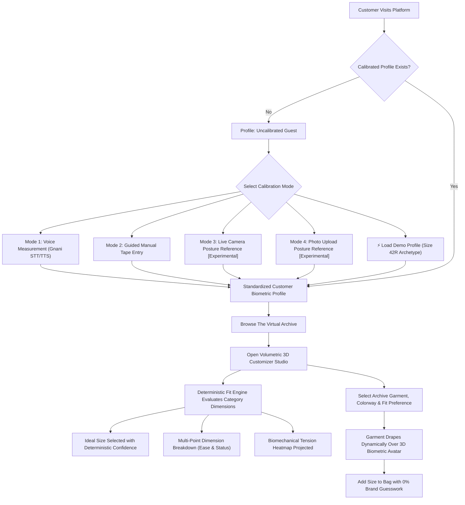

# FitMatch AI — Universal Body Measurement & 3D Volumetric Fit Engine

<div align="center">


**Precision apparel fit, deterministic ease calculations, category-aware dimension scoring, and real-time 3D holographic wardrobe try-on.**

[](#)
[](https://relaxed-concha-1a5f78.netlify.app/)
[](#)
[](#)
[](#)
[](#)
[](#)
[](#)

</div>

---

## Overview

**FitMatch AI** is a minimal luxury fashion-tech platform built to permanently eliminate e-commerce sizing uncertainty and reverse logistics waste. Traditional apparel retail relies on vanity sizing conventions and arbitrary brand comparisons (*e.g., "What size do you wear in Nike or Zara?"*), resulting in return rates exceeding 38% in premium apparel categories.

FitMatch AI replaces brand guesswork with **standardized customer biometric profiles** and **direct physical garment ease comparisons**:

$$\text{Garment Ease} = \text{Physical Garment Dimension} - \text{Customer Body Dimension}$$

The platform couples a **deterministic category-aware sizing algorithm** with a **real-time 3D biometric holographic customizer** that drapes photorealistic garments from **The Virtual Archive** directly over your custom anatomical morphology.

> 🌐 **Live Public Web Application (Netlify):** [https://relaxed-concha-1a5f78.netlify.app/](https://relaxed-concha-1a5f78.netlify.app/)
> 
> 📄 **1-Page Executive Summary & Architecture Proof:** See [`solution.md`](solution.md).

---

## Core Features & Capabilities

### 1. Multi-Modal Universal Body Ingestion

FitMatch AI establishes a single, universal customer measurement profile without pre-populated fake measurements:

* **Clean First-Time Profile & Demo Archetype Separation:**
  * **Empty Initial Profile (`EMPTY_USER_PROFILE`):** First-time visitors start completely clean with all dimensions set to `null` and `verified_by_user: false`. Sizing recommendations and 99.4% confidence guarantees are strictly withheld until the user calibrates their physical dimensions.
  * **Interactive Placeholders:** Input fields display realistic target ranges as light placeholders (*e.g., `e.g. 98 cm`, `e.g. 82 cm`*) rather than pre-filling form values.
  * **Dedicated Demo Archetype (`DEMO_USER_PROFILE`):** Evaluators and reviewers can click `⚡ Load Demo Profile (42R)` in the 3D customizer, manual form, or modal footer to immediately test sizing recommendations on a benchmark 42R morphology without confounding verified biometrics.

* **Mode 1: Hands-Free Voice Assistant (Gnani Vachana v1/v3 + Live WAV Pipeline)**
  * **Zero Client Secrets Architecture:** React Frontend contains zero private API keys. All audio processing and credentials are securely proxied via FastAPI (`http://localhost:8000`).
  * **16kHz PCM WAV Capture & Gnani Prisma STT (`prisma-v2.5`):** Captures clean 16-bit 16kHz mono `.wav` audio streams in-browser via Web Audio (`encodeWAV`) and forwards them to `POST /api/voice/stt` (`https://api.vachana.ai/stt/v3`), paired with Web Speech fast-path previews.
  * **Gnani Timbre Neural TTS (`timbre-v2.5` — Male Voice `Vikrant`):** Wraps Gnani's raw 48kHz linear PCM stream into browser-playable `RIFF` `audio/wav` headers on the backend, warms the opening calibration greeting on FastAPI startup, and locks local fallbacks strictly to consistent male voices.
  * **Concurrency-Safe API Lock & Key Failover:** Serializes TTS/STT cloud requests through a shared `asyncio.Lock` (`api_lock`) to obey Gnani's 1-active-request concurrency limit while routing transient `429` bursts without falsely exhausting API keys.
  * **Acoustic Echo Gating & Conversational 4+4 Flow:** Automatically suspends STT capture during active TTS playback plus a 450ms echo tail cooldown (eliminating mid-word self-cancellation). Follows a guided loop: `"Voice calibration active"` + Timbre Guidance → Listen → Read-back confirmation (*"Your Chest and Bust is 98 centimetres. Is that correct?"*) → Voice `"Confirm"` or tap → Auto-advance across 4 Upper (`Chest / Bust`, `Shoulder Width`, `Neck Circumference`, `Arm / Sleeve Length`) and 4 Lower (`Waistline`, `Hips / Seat`, `Thigh Circumference`, `Inseam`) dimensions, with inline **"✦ Fill 42R Demo"** and **"Confirm ✓"** triggers.
  * **Smart Unit Conversion & Multilingual Bounds Extraction:** Automatically converts imperial shorthands (*e.g. "waist 32" → `81.3 cm`*), supports compound utterances, and parses English, Hindi, and Hinglish aliases (*"chhati"*, *"seena"*, *"kamar"*, *"gala"*, *"baanh"*, *"jaangh"*, *"taang"*) within physiological bounds.
  * **Interactive Anatomical HUD:** SVG body silhouette with dynamic laser highlight bands illuminating each active upper/lower body zone alongside real-time speaking/listening state indicators.

* **Mode 2: Guided Manual Tape Entry**
  * Step-by-step visual placement guides for Chest, Waist, Hips, Shoulders, Neck, Arm/Sleeve length, Thigh, and Inseam.
  * Instant metric ($\text{cm}$) / imperial ($\text{inches}$) conversion.
  * Strict physiological validation bounds (rejecting anatomically impossible inputs).

* **Mode 3: Live Camera Posture Reference [🧪 Experimental UI Prototype]**
  * Direct browser camera stream with holographic A-pose alignment guide and 3-second capture countdown.
  * Captures front and 90° profile posture reference frames stored 100% locally in-browser.
  * Disclaims automated 2D circumference calculation and provides guided tape measurement verification paired with Gnani Timbre spoken tailor instructions.

* **Mode 4: Dual Photo Posture Reference [🧪 Experimental UI Prototype]**
  * Asynchronous front and lateral portrait upload with client-side image format and size validation.
  * Displays proportion reference thumbnails alongside guided manual tape measurement verification with Gnani voice assistance.

---

### 2. Deterministic Category-Aware Fit Engine

Unlike opaque black-box recommendations, FitMatch AI utilizes transparent biomechanical ease formulas:

* **Strict Category-Specific Measurement Enforcement (`validateRequiredMeasurements` & `validateGarmentDimensions`):**
  Before scoring or recommending any garment size, `fitEngine.js` strictly verifies that **all essential body dimensions** declared in `CATEGORIES` exist, are finite numbers $> 0$, and match valid size-chart garment dimensions:
  * **Jeans & Trousers (`jeans`, `trousers`):** Requires **Waist, Hip, Inseam, Thigh** (weights: Waist 0.40, Hip 0.30, Thigh 0.20, Inseam 0.10). Incomplete profiles return `status: "insufficient_data"` with explicit missing dimension badges instead of a misleading fit score.
  * **Tailored Shirts (`shirt`):** Requires **Chest, Waist, Shoulder, Neck, Arm Length** (weights: Chest 0.35, Waist 0.25, Shoulder 0.20, Neck 0.10, Sleeve 0.10).
  * **Jackets & Outerwear (`jacket`):** Requires **Chest, Shoulder, Arm Length** (weights: Chest 0.45, Shoulder 0.35, Sleeve 0.20).
  * **T-Shirts (`tshirt`):** Requires **Chest, Waist, Shoulder** (weights: Chest 0.45, Shoulder 0.30, Waist 0.25).
  * **Dresses (`dress`):** Requires **Chest/Bust, Waist, Hip** (weights: Chest 0.35, Waist 0.35, Hip 0.30).
  * **Product Size-Chart Integrity:** Returns `status: "insufficient_product_data"` if a product's size chart is missing critical corresponding garment columns (`validateGarmentDimensions`).

* **Precise Fabric Stretch Offset:**
  * Fixed stretch factor lookup (`STRETCH_OFFSETS[stretchKey]`) resolving JavaScript's `0`-falsy coercion bug.
  * Rigid textiles (`none`) strictly evaluate to **`0.0 cm`** offset without artificial ease injection.
  * Low stretch evaluates to $+1.2\text{ cm}$, medium to $+2.8\text{ cm}$, and high elastane to $+5.0\text{ cm}$.

* **Category-Specific Deterministic Explanations:**
  * *Trousers:* "Size 32 delivers +4.2cm waist comfort with +5.5cm thigh ease and +3cm inseam break for a tailored regular trouser drape."
  * *Shirts:* "Size 42 (L) provides +16.6cm chest ease with +3cm collar comfort and +3cm sleeve cuff alignment for a bespoke shirt silhouette."
  * *Jackets:* "Size 42R (L) delivers +16cm chest ease and +2.5cm tailored sleeve length over suit canvassing for an architectural outerwear drape."
  * *T-Shirts:* "Size M gives +9.4cm chest room and +1cm torso drape length in pure cotton drape."

* **Asymmetric Penalty Function:** Tightness ($\text{Ease} < \text{Target}$) is penalized **$1.8\times$ to $2.5\times$ more severely** than excess room to prevent unwearable constriction.
* **Critical Minimum Boundary Checks:** Flags dealbreakers where a garment will physically fail to button, zip, or restrict shoulder articulation.
* **Biomechanical Tension Stress Mapping:** Generates tension indexes normalized between $-1.0$ (critical pinch) and $+1.0$ (excess loose).
* **Live Dynamic Dimension Breakdown:** Real-time updates showing exact ease clearances (*e.g., "Waist: +4.2 cm ease • Thigh: +5.5 cm • Inseam: +3.0 cm"*).

---

### 3. Real-Time 3D Biometric Hologram & Virtual Archive Draping

Rendered via Three.js and `@react-three/fiber` inside a cinematic obsidian cyber-pod:

* **Full-Body Biometric Avatar:**
  * Procedurally sculpted anatomical cranium, neck, torso, arms, hands, legs, and feet.
  * Glowing cyan neural constellation wireframe network with 14 anatomical landmark joint nodes.
  * Optimal default camera framing (`fov: 38`, `position: [0, 0.4, 9.2]`) ensuring complete head-to-toe mannequin visibility with $+15\text{--}20\%$ margin.
* **High-Contrast Wardrobe Controls:**
  * **"Draped" / "Naked Scan" Toggle:** Distinct high-contrast styling with glowing cyan text (`text-cyan-300`), icon (`text-cyan-400`), border, and ambient shadow when draped; crisp high-contrast neutral pill when in pure biometric scan mode.
  * **Holographic Fit Bands:** Caliper laser rings at Chest, Waist, and Hips measuring garment clearance in centimeters.
  * **Biomechanical Tension Heatmap Overlay:**
    * 🟢 **Emerald Green:** Optimal Ease (target bespoke comfort).
    * 🔴 **Crimson Red:** Strained Fit ($<0\text{ cm}$ tight constriction/pinch).
    * 🟡 **Amber Yellow:** Snug tailored contour.
    * 🔵 **Cyan Blue:** Loose oversized drape.
* **Photorealistic Virtual Archive Garments (True 3D Tailored Apparel):**
  * **Monochrome Cashmere Blazer & 3-Piece Suit:** Check wool houndstooth/tweed procedural weave, 3D peaked lapels, tailored waistcoat, striped silk necktie with knot and blade, folded crisp white linen pocket square, tailored sleeves with cuffs, and matching suit trousers.
  * **Sculptural Asymmetric Drape Shirt:** Crisp Egyptian white cotton with natural fabric folds, 3D spread collar wings, 3D navy silk tie with white polka dots, long sleeves with buttoned wrist cuffs, tucked into tailored trousers.
  * **Pleated Minimalist Pantalon:** High-waisted tailored waistband with belt loops and silver clasp button, architectural wide-leg drape with sharp vertical pinstripes and front pleat creases breaking over the shoes.
  * **The Sculptural Minimalist Trench:** Double-breasted twill overcoat with broad storm flap lapels, horn buttons, 3D waist belt with brass buckle, and long overcoat sleeves with wrist adjustment straps.
* **Procedural PBR CanvasTextile Engine (`RealGarmentTextures.js`):**
  * High-definition 1024×1024 procedural textures generating houndstooth check wool, pinstripes, twill weaves, silk ties, and buttons with forward-facing UV alignment (`rotation={[0, Math.PI, 0]}`).

---

### 4. Interactive Volumetric 3D Atelier Workspace

* **Category-Specific Missing Dimension Alerts & Badges:** Profiles missing essential dimensions for the active garment display targeted prompts (*e.g., `"To recommend your jeans size accurately, please provide your hip, inseam and thigh measurements."`*) with per-dimension `Missing` badges, suppress false size recommendation indicators, and provide quick actions to calibrate or load the complete 8-dimension 42R Demo Archetype.
* **Active Profile Status Banners:** Visual amber indicators for Demo Mode and emerald badges for verified customer profiles.
* **Full-Width Top Header:** Title and descriptive subtitle span from left to right.
* **4-Column Virtual Archive Recommendation Grid:** Clickable garment cards placed directly below the header with thumbnail images, match scores, prices, and unclipped text.
* **50/50 Balanced Proportional Layout:** Equal-width frames with the 3D viewport stretching vertically to match the live telemetry panel.
* **Dynamic Sizing & Fit Switching:** Instant recalculation when toggling sizes (`S` / `M` / `L` / `XL`) or fit preferences (`Slim` / `Regular` / `Oversized`).

---

### 5. Biomechanical Cloth Physics & Drape Simulator (`FitDemoSection.jsx`)

* **Real-Time Textile Simulation:** Switch between **Raw Cashmere (380 GSM)**, **Mulberry Silk (120 GSM)**, and **Super 150s Wool (290 GSM)**.
* **Dynamic Physical Indicators:**
  * **Torso Compression & Tension (MPa):** Live tensile strain across the torso.
  * **Sleeve Articulation Range (°):** Arm-raise mobility and seam stress.
  * **Thermal Clo Index:** Microclimate breathability and luxury insulation.
* **Uncalibrated Telemetry State:** Displays clean `"Pending Calibration"` indicators rather than falling back to unverified measurements.

---

## System Architecture & Directory Layout

```text
FitMatch AI/
├── solution.md                  # 1-page architecture brief & Gnani API/UI proof
├── docs/screenshots/            # System architecture diagram & frontend/API visuals
├── index.html                   # HTML entry with Playfair & JetBrains font imports
├── vite.config.js               # Optimized Vite bundler configuration
├── tailwind.config.js           # Custom luxury dark-mode theme & glassmorphic utilities
├── postcss.config.js            # PostCSS plugin configurations
├── .gitignore                   # Production repository exclusions
│
├── backend/                     # Secure FastAPI Voice & Biometric Proxy
│   ├── requirements.txt         # FastAPI, Uvicorn, httpx, pydantic dependencies
│   ├── .env.example             # Template for GNANI_ACCESS_KEY, GNANI_TOKEN, GNANI_LANG
│   └── app/
│       ├── main.py              # FastAPI app factory, CORS, & startup voice cache warm-up
│       ├── config.py            # Vachana endpoints (`api.vachana.ai`), Vikrant voice & keys
│       ├── routes/
│       │   └── voice.py         # /api/voice/{stt,tts,extract,status,reset-keys}
│       └── services/
│           ├── gnani_stt.py     # Gnani Prisma v3 WAV transcription proxy
│           ├── gnani_tts.py     # Gnani Timbre v2.5 synthesis + 48kHz RIFF WAV wrapper
│           ├── gnani_fallback.py # Global asyncio API lock & key failover manager
│           └── measurement_extractor.py # NLP numeric parser, smart inch conversion & bounds
│
└── src/
    ├── main.jsx                 # React root mount
    ├── App.jsx                  # Master application orchestrator & local storage sync
    ├── index.css                # Global glassmorphism, fonts, and scrollbar rules
    │
    ├── data/
    │   └── products.js          # The Virtual Archive physical garment specifications
    │
    ├── engine/
    │   ├── types.js             # Bounds, categories, EMPTY_USER_PROFILE, DEMO_USER_PROFILE
    │   └── fitEngine.js         # Deterministic category-aware sizing algorithm & tension map
    │
    ├── services/
    │   └── voiceMeasurementService.js # Frontend speech recording & Gnani backend connector
    │
    └── components/
        ├── 3d/
        │   ├── BiometricHologramModel.jsx # Full-body avatar & Virtual Archive 3D apparel
        │   ├── RealGarmentTextures.js     # High-definition procedural PBR textile generators
        │   ├── ParametricMannequin.jsx    # R3F canvas, cyber lights, & OrbitControls
        │   ├── GarmentHeroScene.jsx       # Hero 3D turntable scene
        │   └── CyberAvatarModel.jsx       # Standalone biometric avatar module
        │
        ├── common/
        │   └── Navbar.jsx                 # Luxury glassmorphic navigation header
        │
        ├── hero/
        │   ├── HeroSection.jsx            # Headline, 3D cyber-pod, and telemetry triggers
        │   └── FloatingProductCards.jsx   # Interactive LiDAR HUD telemetry cards
        │
        ├── onboarding/
        │   ├── FitFinderModal.jsx         # Master multi-modal onboarding modal
        │   ├── VoiceMeasurementFlow.jsx   # Microphone capture & voice guidance
        │   ├── ManualMeasurementFlow.jsx  # Interactive tape measurement entry
        │   ├── LiveCameraFlow.jsx         # Camera stream & guided tape measurement
        │   └── PhotoUploadFlow.jsx        # Dual-angle photo reference & guided tape entry
        │
        ├── fit-engine/
        │   └── FitDemoSection.jsx         # Live interactive cloth physics simulator
        │
        └── studio/
            ├── ProductStudio3D.jsx        # 50/50 Volumetric Atelier, 4-col archive grid, & telemetry
            └── FitFeedbackModal.jsx       # Customer calibration feedback dialog
```

---

## Tech Stack

| Domain | Technology | Description |
| :--- | :--- | :--- |
| **Frontend Framework** | **React 18** | Concurrent rendering, state persistence, modular architecture |
| **Backend Proxy** | **FastAPI (Python 3.10+)** | High-performance asynchronous API proxy, failover & validation |
| **Voice AI Engine** | **Gnani Prisma & Timbre** | Real microphone audio buffer STT, neural TTS synthesis & voice cloning |
| **3D Rendering** | **Three.js** | WebGL graphics, custom procedural spline lathes, PBR materials |
| **3D React Bridge** | **@react-three/fiber** | Declarative Three.js scene graph inside React components |
| **3D Utilities** | **@react-three/drei** | `OrbitControls`, `Float`, `ContactShadows`, procedural lighting |
| **Styling & Design** | **Tailwind CSS** | Custom obsidian luxury palette, glassmorphism, responsive grids |
| **Animation** | **Framer Motion** | Spring-based transitions, dialog animations, and gesture triggers |
| **Icons** | **Lucide React** | Minimalist fashion-tech iconography |
| **Build Tooling** | **Vite 5** | Instant Hot Module Replacement (HMR) and optimized rollup bundle |

---

## Getting Started Locally

### Prerequisites
* **Node.js**: v18.0.0 or higher & **npm**: v9.0.0 or higher
* **Python**: v3.10+ (for FastAPI secure backend proxy)

### 1. Backend Setup (FastAPI Proxy)
```bash
# Navigate to backend directory
cd backend

# Install Python requirements
pip install -r requirements.txt

# Configure backend environment variables
cp .env.example .env
# Fill in your GNANI_ACCESS_KEY, GNANI_TOKEN, GNANI_VOICE, GNANI_LANG, etc.

# Start FastAPI voice proxy server
python -m uvicorn app.main:app --host 0.0.0.0 --port 8000
```
Backend runs at [http://localhost:8000](http://localhost:8000) (Interactive OpenAPI documentation at `/docs`).

### 2. Frontend Setup (React 18 + Vite)
```bash
# In the project root:
npm install

# Configure frontend environment variables
cp .env.example .env
# Sets VITE_API_BASE_URL=http://localhost:8000 (No API secrets on client!)

# Start Vite dev server
npm run dev
```
Open [http://localhost:3000](http://localhost:3000) in your browser.

### 3. Production Build
```bash
npm run build
```
The production bundle generates in `dist/`. Client scripts are completely free of private API keys.

### 4. Live Public Deployment (Netlify)
The frontend web application is hosted and publicly accessible at:
* **Production URL:** [https://relaxed-concha-1a5f78.netlify.app/](https://relaxed-concha-1a5f78.netlify.app/)
* **Zero Client Secrets:** Production builds bundle exclusively client WebGL & Web Audio assets; voice and measurement proxies connect cleanly to the backend API without baking credentials into client bundles.

---

## User Workflows



---

## License & Attribution

Released under the **[MIT License](LICENSE)**.  
Copyright © 2026 **Madhav Kumar**. All rights reserved.

Codebase authored and engineered by [@maddycode5](https://github.com/maddycode5).
