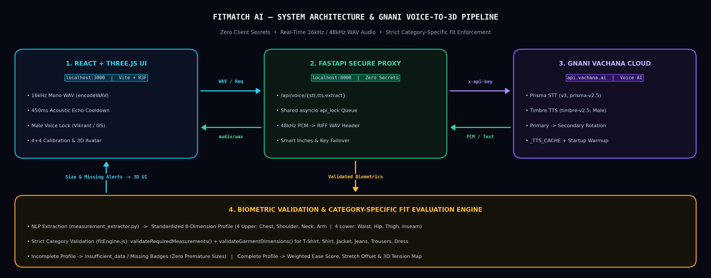
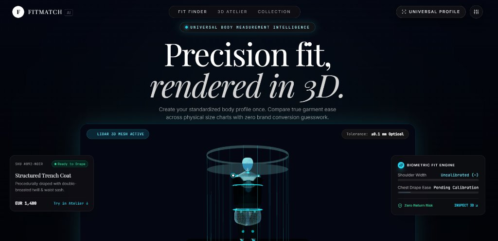
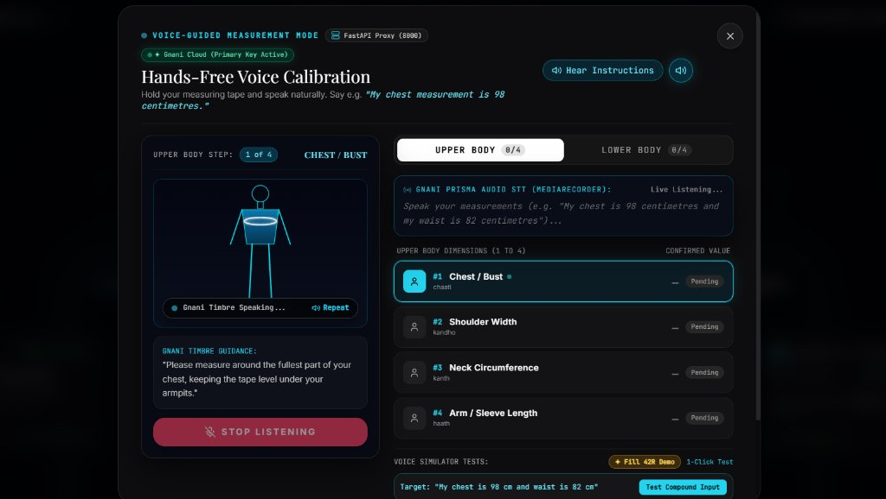
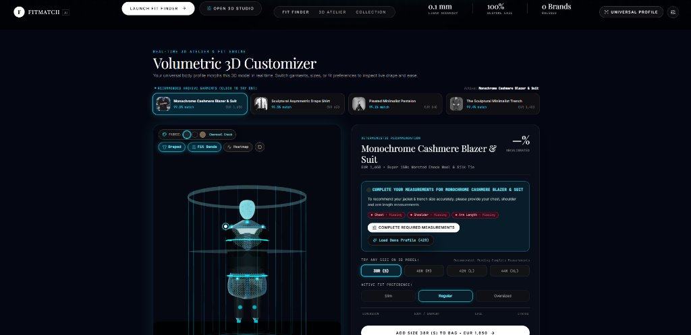
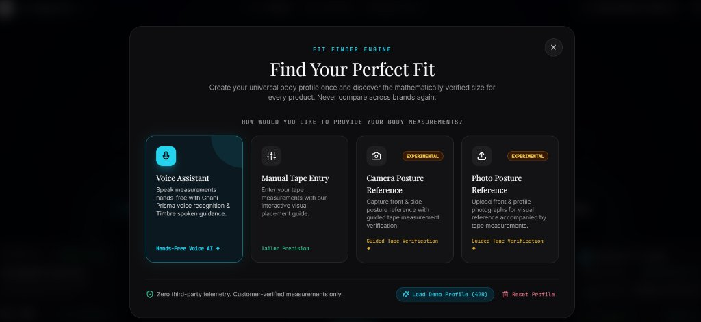
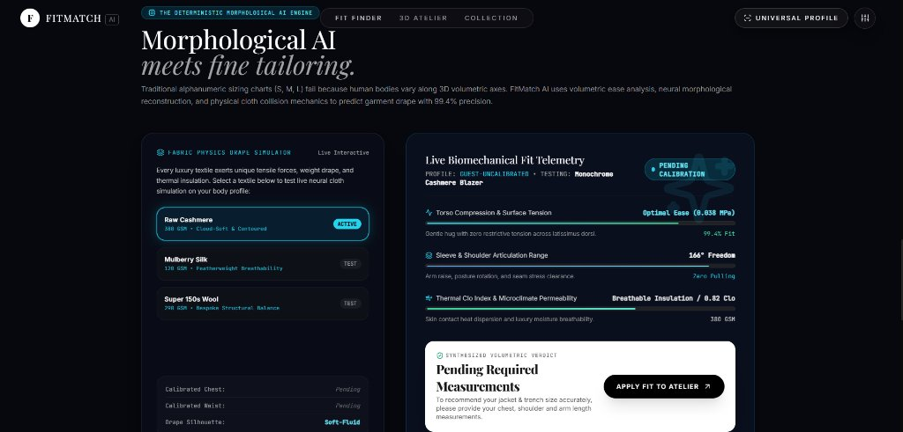
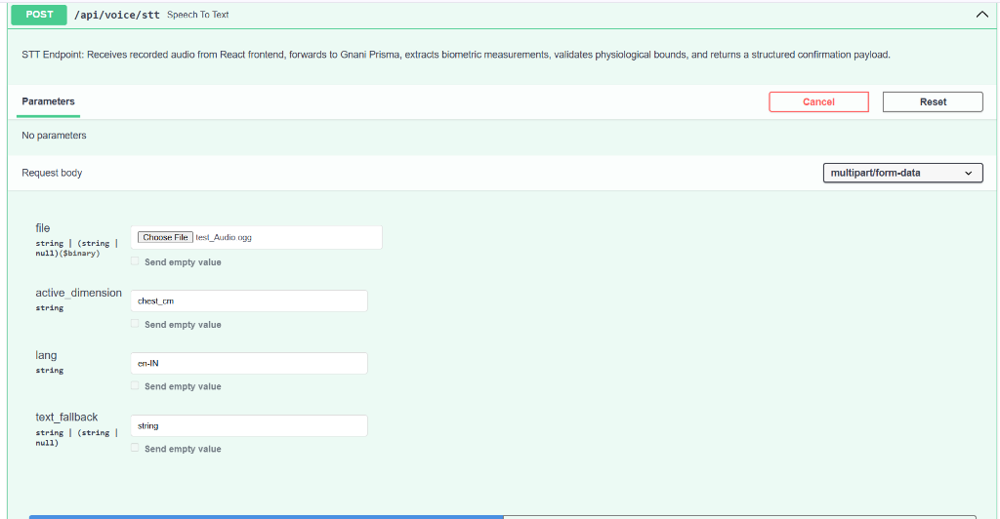
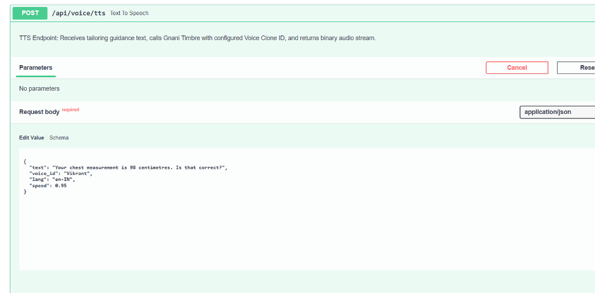
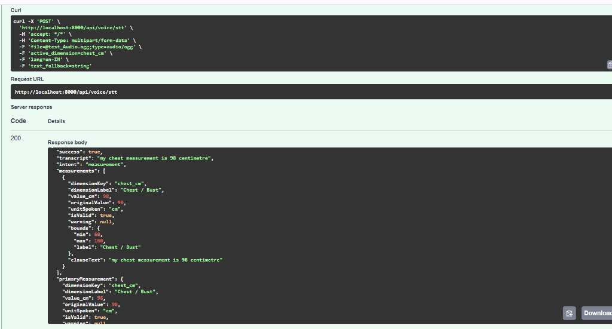
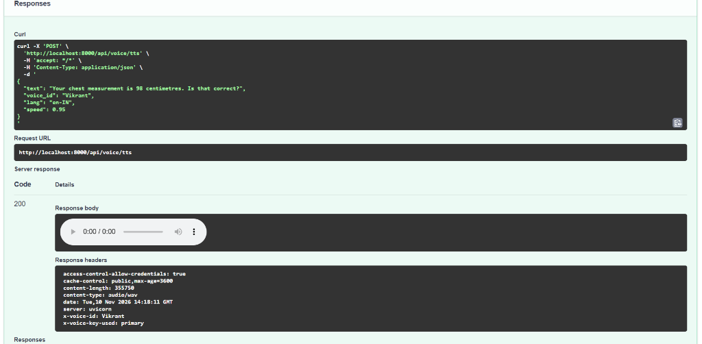

# FitMatch AI — 1-Page Solution Brief

>**Universal 8-Dimension Body Profiling, Hands-Free Gnani Voice-Guided Measurement & 3D Fit Intelligence Engine**  
>🌐 **Live Web Application:** [https://relaxed-concha-1a5f78.netlify.app/](https://relaxed-concha-1a5f78.netlify.app/) &nbsp;|&nbsp; 💻 **Repository:** [github.com/maddycode5/FitMatch-AI](https://github.com/maddycode5/FitMatch-AI)

## 1. Project Overview
**FitMatch AI** eliminates apparel sizing guesswork by pairing an **8-dimension biometric body profile** (Upper Body: *Chest, Shoulder, Neck, Arm Length*; Lower Body: *Waist, Hip, Thigh, Inseam*) with a **category-specific deterministic fit engine** and a **real-time Three.js 3D studio**. Customers calibrate hands-free using conversational voice guidance (**Gnani Prisma STT** + **Gnani Timbre TTS** via a zero-secret FastAPI proxy) or manual entry, inspect 3D garment drape and tension heatmaps, and view exact garment-ease scores ($\text{Ease} = \text{Garment Spec} - \text{Body Spec}$).

## 2. Problem Statement

- **Inconsistent Clothing Sizes Across Brands:** Different brands follow different sizing standards, meaning identical size labels (S, M, L or 42R) can represent different garment dimensions. This makes it difficult for customers to identify the right size when shopping online.

- **Incomplete Measurement-Based Recommendations:** Traditional sizing systems often depend on limited body measurements and overlook critical dimensions such as chest, shoulder, waist, hip, thigh and inseam. This can lead to poor-fitting garments, uncomfortable purchases and avoidable returns.

- **Difficult and Inconvenient Body Measurement:** Accurately measuring multiple body dimensions using a measuring tape can be confusing, time-consuming and prone to human error. Customers need a simpler, guided and accessible way to record and verify their measurements.

## 3. Proposed Solution

- **Universal 8-Dimension Body Profiling & Category-Specific Validation:** FitMatch AI creates a reusable body measurement profile covering Chest, Shoulder, Neck, Arm Length, Waist, Hip, Thigh and Inseam. Before generating a recommendation, the deterministic fit engine validates the measurements required for each garment category and checks the availability of corresponding garment dimensions. It prevents unreliable recommendations by identifying missing user measurements or incomplete product size charts.

- **Deterministic Fit Intelligence & 3D Garment Visualization:** The fit engine compares body measurements against actual garment dimensions using garment ease analysis (Ease = Garment Measurement − Body Measurement). It evaluates multiple fit dimensions, accounts for fabric stretch and applies fit-preference-based scoring for Slim, Regular and Oversized styles. The Three.js-powered 3D studio complements this analysis with interactive garment visualization, fabric simulation and fit telemetry, helping users understand garment fit beyond conventional size labels.

- **Gnani-Powered Hands-Free Measurement Assistance:** Integrating Gnani Prisma Speech-to-Text (STT) and Gnani Timbre Text-to-Speech (TTS), FitMatch AI enables users to speak their body measurements and receive spoken measurement guidance. Recognized values are extracted, validated against dimension-specific limits and presented for user confirmation before being added to the measurement profile. Manual measurement entry is also available.

## 4. Gnani AI Integration
* **Gnani Timbre TTS (`api.vachana.ai/api/v1/tts/inference`, `timbre-v2.5`, Male `Vikrant`):** FastAPI wraps headerless 48kHz PCM streams into playable `RIFF` `audio/wav` buffers (`_ensure_playable_audio`), warms the opening prompt at startup, caches prompts (`_TTS_CACHE`), and locks offline fallback strictly to consistent OS male voices (`selectConsistentMaleVoice`).
* **Gnani Prisma STT (`api.vachana.ai/stt/v3`, `prisma-v2.5`, `en-IN`):** Browser encodes clean 16kHz mono `.wav` (`encodeWAV`), pauses capture during active TTS + 450ms echo cooldown (`isInEchoCooldown`), and routes all calls through a shared `asyncio api_lock` + Primary/Secondary key failover (`gnani_fallback.py`). `measurement_extractor.py` parses En/Hi/Hinglish numbers with smart inch auto-conversion (`"waist 32" → 81.3 cm`).

## 5. Technology Stack

| Layer | Stack (`FitMatch-AI-main`) |
| :--- | :--- |
| **Frontend & 3D WebGL** | React `18.3.1`, Vite `5.2.11`, Three.js `0.164.1`, `@react-three/fiber` `8.16.6`, `@react-three/drei` `9.105.6`, Tailwind CSS `3.4.3`, Framer Motion `11.2.10` |
| **Backend Proxy & NLP** | Python FastAPI `>=0.110.0`, Uvicorn `>=0.28.0`, HTTPX `>=0.27.0`, Pydantic Settings `>=2.2.0` |
| **Voice AI Platform** | Gnani Vachana Cloud (**Prisma `prisma-v2.5` STT** & **Timbre `timbre-v2.5` Male `Vikrant` TTS**), Web Audio 16kHz PCM WAV |

## 6. Screenshots & Architecture

* **Implemented Architecture:** React frontend → FastAPI services → Gnani STT/TTS, with measurement validation and product-specific fit evaluation.

* **Actual FitMatch AI Frontend:** Homepage 3D LiDAR experience, multi-modal Fit Finder, Voice Calibration HUD, category validation & fabric telemetry.

| Homepage & 3D Fit Scene | Voice Calibration (Gnani Primary) | 3D Customizer & Missing Dim Validation |
| :---: | :---: | :---: |
|  |  |  |
| **Multi-Modal Fit Finder** | **Biomechanical Fabric Physics** | **Virtual Archive Collection** |
|  |  |  |

* **Gnani API Evidence:** Live STT audio upload & structured measurement response alongside TTS `Vikrant` `audio/wav` response.

| Gnani STT (`POST /api/voice/stt`) | Gnani TTS (`POST /api/voice/tts`) |
| :---: | :---: |
|  |  |
|  |  |

## 7. Impact
* **Verified Fit Precision:** Eliminates incomplete single-metric sizing by validating every required body & chart dimension per clothing category before displaying a recommendation.
* **Hands-Free Voice Reliability:** Zero-echo 16kHz/48kHz WAV audio, consistent male neural voice guidance, and multilingual inch/cm parsing unlock seamless accessibility while holding a measuring tape.
* **Production Resilience:** Zero exposed client secrets, serialized `api_lock` concurrency handling, startup prompt caching, and automated multi-key failover prevent API stalls.
